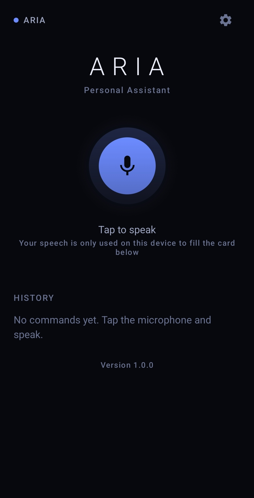
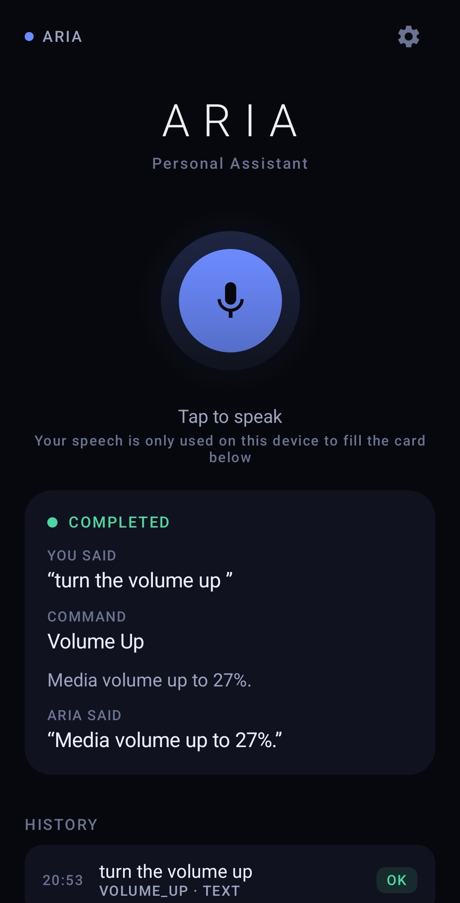
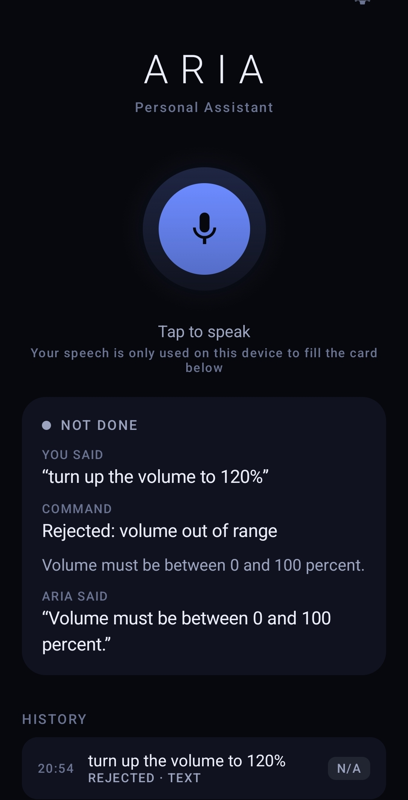

# ARIA

A personal Android voice assistant. Speak a command, ARIA parses it, performs a real
Android action, and says **what actually happened** — including when the answer is no.

**Native Kotlin + Jetpack Compose.** Version 1.0.0 · `minSdk 26` · `targetSdk 35`.

> **Read [`PROJECT_STATUS.md`](PROJECT_STATUS.md) first** — it is the single source of
> truth for what has been verified, by whom, and when. Architecture and the reasoning
> behind every decision are in [`docs/PROJECT_GUIDE.md`](docs/PROJECT_GUIDE.md).

---

## Verified on a real device

| | |
|---|---|
| **Unit tests** | **390 passing** — `:app:testDebugUnitTest --rerun-tasks` |
| **Instrumented tests** | **30 / 30 passing** on a **Samsung SM-A566B (Android 17)** |
| **Manual checklist** | passed — speech, TTS, permissions, history, rotation, force-stop persistence |

Counted from source today: `grep -rc "@Test" app/src/test` → 390, `app/src/androidTest` → 30.
The authoritative record, including what the authoring agent could *not* do and why that
is not the same as "unverified", is [`PROJECT_STATUS.md`](PROJECT_STATUS.md).

---

## Architecture

One pipeline. Voice and the debug text box are two **inputs** into the *same* path — not
two paths that must be kept in sync.

```
        🎤 Microphone                                    ⌨ Debug text field
             │                                                   │
             ▼                                                   │  (debug mode only)
   SpeechRecognizerManager                                       │
   (android.speech recogniser,                                   │
    emits events, not Bundles)                                   │
             │  final transcript: String                        │
             └──────────────────┬────────────────────────────────┘
                                ▼
                    AssistantViewModel.runCommand()
             ══════════════════╪══════════════════════════════════
                               │
                    ┌──────────▼──────────┐
                    │   CommandParser     │ ◄── SEAM: an *interface*
                    └──────────┬──────────┘     (RuleBasedCommandParser today,
                               │                 an LlmCommandParser later)
                               ▼
                      AssistantCommand  (pure Kotlin data; no android.*)
                               │
                    ┌──────────▼──────────┐
                    │   ActionExecutor    │  (interface)
                    └──────────┬──────────┘
                               ▼
                   AndroidActionExecutor ── one handler per domain
                    │VolumeActionHandler    │MapsActionHandler
                    │SoundModeActionHandler │MediaActionHandler
                    │AppActionHandler       │SettingsActionHandler
                               │  each talks through a small port
                               ▼  (AudioVolumeController, RingerController,
                                  MediaKeyController, InstalledAppsProvider, Launcher)
                         Android APIs
                               │
                               ▼
                       ExecutionResult
             Success · Failure · NotUnderstood ·
             RequiresPermission · NotSupported
                               │
                               ▼
              AssistantViewModel.publish()  ── decides the card
                    │                    │
                    ▼                    ▼
            TextToSpeechManager     HistoryStore
            (speaks the reply)      (JSON file, capped at 200)
```

### The seam that matters

`CommandParser` is an **interface**, and `AssistantViewModel` holds only the interface.
`RuleBasedCommandParser` is the V1 implementation; a future `LlmCommandParser` can replace
it **without touching a single line of the action layer, the UI, or the history code** —
the action layer's entire input contract is `AssistantCommand`, a pure-Kotlin sealed type.
That is also why the parser and command model carry **145 tests** of their own, with no Android in sight.

### Why the ViewModel never imports `android.*`

Verified, not asserted — the ViewModel's import list contains **no `android.*` at all**
(and neither does the whole `command/` package). Everything it touches is either pure
Kotlin or a port this project owns:

- `SpeechRecognizerManager` — emits `SpeechEvent`, not a `Bundle` or an error code
- `TextToSpeechManager` — emits `TtsEvent`, not a `TextToSpeech` status int
- `MicrophonePermissionChecker` — a `Boolean`, not a `Context`
- `HistoryStore`, `ActionExecutor`, `CommandParser` — plain interfaces

**What that buys:** the entire round trip — transcript in, parsed command, action result,
card state, history row, spoken reply — runs on a plain JVM against fakes. That is how
390 unit tests exist for a voice assistant without a device or an emulator, and why a
concurrency bug in the history path (R1) could be reproduced deterministically instead of
guessed at on a phone.

---

## Tech stack

| Layer | Choice | Notes |
|---|---|---|
| Language | **Kotlin 2.0.21**, JVM target 17 | |
| UI | **Jetpack Compose + Material 3** (BOM 2024.12.01) | single Activity, all composables |
| Async | **Coroutines + `StateFlow`** | one immutable `AssistantUiState`, no mutable UI fields |
| Architecture | **MVVM, plain constructor injection** | `ViewModelFactory` + `AriaApplication`; no DI framework |
| Build | **Gradle Kotlin DSL + version catalog** | AGP 8.7.3, every version in `gradle/libs.versions.toml` |
| SDK | **`minSdk 26` · `targetSdk 35` · `compileSdk 35`** | API 26 is why `java.nio.file` atomic moves need no desugaring |
| Tests | **JUnit 4 + Compose UI Test** | coroutines-test 1.8.1, espresso 3.7.0, androidx.test 1.3.0 |

### Deliberate omissions, and why

- **No Hilt / Koin.** The dependency graph is one ViewModel, one Application and a
  handful of ports. A factory does that in ~40 readable lines with no annotation
  processor and no build-time cost. Hilt would be justified the moment there are
  multiple screens with scopes — there is exactly one screen.
- **No Room / DataStore.** The history is one flat list of at most 200 small records,
  always read and written **whole**. Room would add KSP and an annotation processor to a
  problem that needs `File.writeText`. See `docs/PHASE12.md` §1 — Room stays the V2 answer
  if history ever needs queries, filters or migrations.
- **No network access at all.** There is no `INTERNET` permission in the manifest, so the
  app *cannot* phone home even if a future edit tried. Note the limit that does *not*
  cover: recognition runs in the *system* speech service, which has its own permissions —
  see [Privacy](#privacy).
- **No LLM in V1.** Precision over recall: a rule-based parser that refuses honestly beats
  a model that guesses fluently. The `CommandParser` interface means adding one later is a
  new class, not a rewrite.

Also absent on purpose: `material-icons-extended` (thousands of vectors; the one custom
icon is hand-drawn in `ui/theme/AriaIcons.kt`), and any analytics or crash reporting.

---

## What you can say

Two columns, and the second one is a promise about wording, not just behaviour.

| You say | What happens |
|---|---|
| "turn the volume up" | Media volume rises one step. ARIA reports the level **read back** from the device — "Media volume up to 54%", never "increased by 10%". |
| "set the volume to 30 percent" | Sets it, reads it back, and reports the **real** level: *"Media volume is now 30%."* If the device declines, it says the actual value instead of the one requested — *"Media volume could not be set to 20%; it is 60%."* |
| "turn my phone silent" | Switches the ringer to silent — **verified by reading the mode back**, since `setRingerMode` is a request, not a command. |
| "play music" | **Opens your music app.** It does not start playback and cannot choose a track — there is no public API for that, so ARIA says "Opening your music app" and never "Playing". |
| "navigate to Milan" | **Hands off** to your map app with a `google.navigation:` intent — "Opening navigation to Milan in your map app." Whether it routes is the other app's business. |
| "find cafes" / "search for cafes" | Opens a `geo:` map search. Again a hand-off: ARIA hands the query over and does not search itself. |
| "open Chrome" | Launches the app by name. If nothing matches, it says "Could not find an app named …" rather than silently doing nothing. |
| "open something" / "open it" | No real app name, so it is **not** guessed at: this lands on `Unknown` → *"I didn't understand that command."* rather than opening a random app. |

### And the cases where the honest answer is "no"

These are the differentiator, so they get their own table. Each sentence below is the
exact constant in `actions/ActionMessages.kt`.

| You say | What ARIA does |
|---|---|
| "set the volume to **120** percent" | **Refuses**: *"Volume must be between 0 and 100 percent."* It does not clamp to 100 and report success — that would hide that the request was impossible. |
| "set the volume to 30 percent **and turn off wifi**" | **Refuses the whole thing**: *"I can only handle one command at a time."* It does not do half and stay quiet about the rest. |
| "**find my phone**" | **Declines.** ARIA cannot locate your property, and a map search for the literal words "my phone" would be a confident wrong answer. |
| a sound-mode change without DND access | **Explains, changes nothing**: *"ARIA needs Do Not Disturb access to change sound modes."* It never opens settings or grants it itself — only reports the missing grant. |
| anything unrecognised | *"I didn't understand that command."* — a **neutral** card, not a red failure. Nothing was attempted, so nothing failed. |

Partial understanding is the trap this design avoids: several of the sentences above
*would* parse if ARIA only tried harder, and every one of them would then produce a
confident wrong answer.

---

## Build and install

**Prerequisites:** JDK 17 and the Android SDK (Android Studio installs both). The Gradle
wrapper fetches everything else — no separate Gradle install needed.

```powershell
git clone <repo> ARIA
cd ARIA

.\gradlew :app:assembleDebug        # APK → app/build/outputs/apk/debug/app-debug.apk
.\gradlew :app:testDebugUnitTest    # 390 unit tests, no device needed
```

### Run it on your phone

1. **Enable Developer options** — Settings → About phone → tap **Build number** 7 times.
2. **Enable USB debugging** — Settings → Developer options → **USB debugging** on.
3. Plug the phone in, unlock it, and accept the **"Allow USB debugging?"** prompt.
   (If it never appears, set the USB mode to *File transfer / MTP* rather than
   *Charging only*.)
4. Confirm the device is visible:
   ```powershell
   adb devices          # → <serial>  device
   ```
5. Install and launch:
   ```powershell
   .\gradlew :app:installDebug
   adb shell am start -n com.example.aria/.MainActivity
   ```
   Or install the APK directly from step 1:
   ```powershell
   adb install -r app\build\outputs\apk\debug\app-debug.apk
   ```
6. Tap the microphone and allow the permission when Android asks. Speak a command.

Instrumented tests need the same connected device:

```powershell
.\gradlew :app:connectedDebugAndroidTest      # 30 tests on the device
```

### A note on the Maven mirrors in `settings.gradle.kts`

That file lists **regional Maven mirrors** (Iranian and Chinese) ahead of `google()`,
`mavenCentral()` and `gradlePluginPortal()`. They are there because the official hosts
were unreachable from the author's network, and Gradle cannot fetch a plugin it cannot
reach.

If you clone this on a normal network and those mirrors are slow or dead, **you can
delete the mirror block** — the official repositories are already last in both lists, so
removing the mirrors leaves a working configuration. No dependency version lives in that
file, so doing so cannot change what gets built.

### Try the parser without a microphone

Turn on **debug mode** (settings gear → Debug mode) to reveal a text field. Typing a
command goes through `onSubmitTextInput` → the *same* `runCommand` the recogniser calls,
so typed and spoken commands cannot drift apart. This is also how the parser is exercised
on a device without saying anything out loud.

---
## Screenshots

### Home


### Successful command


### Rejected command


## Documentation map

| File | What it is |
|---|---|
| [`PROJECT_STATUS.md`](PROJECT_STATUS.md) | **Authoritative status.** Hardware verification vs. agent limits, counts, dates, what is next, what is deferred |
| [`docs/PROJECT_GUIDE.md`](docs/PROJECT_GUIDE.md) | Architecture, seams, and why each decision was made |
| [`docs/PHASE-R1.md`](docs/PHASE-R1.md) | The correctness pass: four concurrency/durability defects, code quoted before and after |
| [`docs/PHASE*.md`](docs/) | Per-phase record, including corrections and what each phase could not verify |
| [`docs/TROUBLESHOOTING.md`](docs/TROUBLESHOOTING.md) | Read this first if a build fails |
| [`FILE_MANIFEST.txt`](FILE_MANIFEST.txt) | Every tracked file with a checksum |

## Privacy

**What ARIA itself does and does not do — all of it verifiable in this repo:**

- **No audio is retained.** ARIA never writes a recording, keeps a buffer of samples, or
  stores audio anywhere. There is no such code path.
- **No `INTERNET` permission.** It is absent from `AndroidManifest.xml`, so ARIA cannot
  make a network call even if a future edit tried to.
- **No LLM, no analytics, no crash reporting.** Nothing added by this project talks to a
  server.
- **History stays local** — a private JSON file, **excluded from cloud backup and device
  transfer**. Transcripts are the most private thing this app produces.

**What ARIA does not control — the honest limit:**

Speech recognition is performed by **Android's built-in `SpeechRecognizer`**, which ARIA
binds to like any other app. That recogniser is a **separate system service in another
app's process, with its own permissions and its own configuration**. Depending on your
device and that service's settings, speech may be processed off-device. ARIA has no
visibility into it and cannot prevent it.

Nor is the offline path a guarantee: ARIA *can* pass `EXTRA_PREFER_OFFLINE`, and that
extra is a **hint the platform is free to ignore** — and the flag defaults to `false`
anyway, because devices without a downloaded offline model fail outright instead of
falling back. So ARIA cannot claim on-device-only recognition today.

> **In one line:** ARIA stores no audio and never sends anything, but the speech service
> it hands audio to is the device's, not ARIA's — so "on-device recognition" would be a
> promise this project cannot keep. Guaranteed on-device recognition is deferred to
> V1.1; see `PROJECT_STATUS.md`.

## Licence

**MIT** — see [`LICENSE`](LICENSE).

## A note on the record

Most of this project was written in a sandbox with **no JDK and no Android SDK**, so the
authoring agent compiled nothing. Every phase was then built, tested and verified **by the
owner on a physical Samsung device**. Both statements are true at once, and keeping them
separate is the point: a "not executed" note in a phase document describes the agent's
environment, never the project's state.
